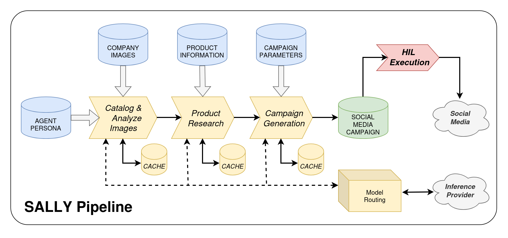
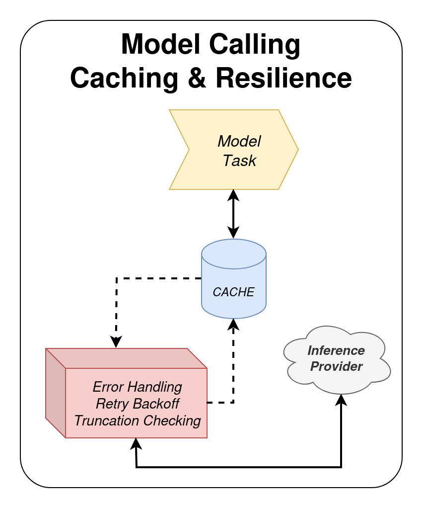

# SALLY

**S**oci**ALLY** is a small and extensible social media campaign AI agent harness. **SALLY** look through your brand photos, reads all of your product blog posts and listings, and then drafts social media campaigns for human review and execution. **It never posts anything.** All company, brand, and product specifics come from custom context, the harness itself is totally un-opinionated and company-agnostic.

<p >
   
</p>

## Pipeline

| Stage | Input | What happens | Output |
|---|---|---|---|
| **Catalog & Analyze Images** | `images/` | A vision model describes each photo in batches (mood, composition, contents, etc). | `output/image_inventory.json` |
| **Product Research** | `sources/` | A writing model writes Markdown research notes for each blog post or listing (only what it explicitly states: sourced facts, pricing, limitations, story angles), then merges all notes into one product brief. | `output/research/*.md` (per source), `output/product_brief.md` |
| **Campaign Generation** | `agent/*.md` + the image inventory + the product brief | Drafts three distinct brand-awareness campaigns as a Markdown report. Product claims must trace to the brief; limitations are always stated. | `output/campaigns_raw.txt` (Markdown report) |
| **HIL Campaign Execution** | Drafts | A human reviews, approves, and publishes. Not automated. | Social media |

All model calls go through a single routing layer ([libs/model.py](libs/model.py)) to an OpenRouter-fronted inference provider. The vision and writing models are configured independently.

Both the inventory and the research are cached, so reruns only process new or changed files.

## Setup

```bash
python -m venv .venv && source .venv/bin/activate
pip install -r requirements.txt
```

Copy `.env.template` to `.env` and add your OpenRouter API key where indicated. While you're editing `.env`, there is additional (optional) tuning available: `IMAGE_BATCH_SIZE`, `MAX_RETRIES`, `SLEEP_BETWEEN_CALLS`, `MAX_IMAGE_EDGE`, `REASONING_EFFORT` (default `low`; reasoning models spend `max_tokens` on thinking, so raise it or lower the effort if you see empty responses), `FORCE_REINVENTORY=1` (re-analyze all photos and sources). Token limits and temperatures per stage are constants in [libs/config.py](libs/config.py) but can be wired to the `.env` file if desired.

## Usage

1. Describe your company in `agent/`. `AGENT.md`, `IDENTITY.md`, and `SOUL.md` are generic persona and rules that work as-is. `USER.md` is a template full of `TBD` answers, and it is where all company-specific context lives. See [Filling out USER.md](#filling-out-usermd).
2. Put photos (jpg, png, webp, gif) in `images/`.
3. Put product material in `sources/`:
   - Existing `.md`, `.txt`, or `.html` files (blog posts, product listings)
   - Optionally - Add public URLs to `sources/urls.txt`, one URL per line (starting with `#`, for comments). These are pre-fetched (via `playwright`) at the start of the research stage and saved as plain text in `sources/fetched/` (inspect or edit them there). Already-fetched URLs are skipped; use `python run_agent.py --refetch` to download them again.
   - PDFs aren't supported; paste the text into a `.md`. If a page has little text in its raw HTML (React and other JavaScript-rendered sites), the fetcher re-loads it in headless Chromium via Playwright. One-time setup: `playwright install chromium`. Pages behind a login or bot block still need to be copied into a `.md` by hand.
4. Run:

```bash
python run_agent.py
```

If `sources/` is empty the run still works on photos alone, but the model is told to make no product claims beyond what the photos show.

### Filling out USER.md

[ChatGPT - Can you help me do this?](chatgpt.com/?q=Can%20you%20read%20the%20USER.md%20file%20for%20https%3A%2F%2Fgithub.com%2F315Concepts%2Fsally-pipeline%20and%20help%20me%20fill%20it%20out%3F)

`agent/USER.md` is a questionnaire covering your company, products, audience, voice, goals, platforms, capacity, and guardrails. Anything left as `TBD` is treated as "not provided" and the model won't guess, so the more you fill in, the better the drafts. You can do it by hand, but even better would be to have a chat assistant interview you. Keep `USER.md` factual. Don't put secrets, credentials, or private customer data in it: the whole persona folder is sent to the model provider with every request.

## Free Tier

**SALLY** does no inference on the host: it only reads files, builds prompts and makes API calls. That means you can run it for free on a CPU-only machine, with the models hosted elsewhere - a small campaign set with 8-10 photos, 5 blog/web resources, and three generated _campaign tracks_ takes ~ 5-10 minutes to create.

**Models: OpenRouter**

1. Create an account at [openrouter.ai](https://openrouter.ai) and generate a key under *Keys*.
2. Pick models whose id ends in `:free` from the [models list](https://openrouter.ai/models?max_price=0) (filter by price = free). `VISION_MODEL` must list image input; `WRITING_MODEL` only needs text.
3. Put the key and model ids in `.env` (see [Setup](#setup)).

Free models are rate-limited (requests per minute and per day, and tighter until you've added a small credit balance), so keep `IMAGE_BATCH_SIZE` small and raise `SLEEP_BETWEEN_CALLS` if you hit 429s.

**Compute: Lightning AI (CPU Studio)**

1. Sign up at [lightning.ai](https://lightning.ai) and create a new Studio. Leave it on the default **CPU** machine; no GPU is needed.
2. Open the Studio terminal, then clone or upload this project and follow [Setup](#setup). Run `playwright install chromium` if you use `sources/urls.txt`.
3. Add `.env` with your OpenRouter key and drop your photos and sources into `images/` and `sources/`, then `python run_agent.py`.
4. Download `output/campaigns_raw.txt` when done. Studios have a monthly free-credit allowance and sleep when idle, and the CPU tier is more than enough for this workload.

**_Free-tier quotas and offerings change often, so check each provider's current limits._**

## Project layout

```
agent/            AGENT.md, IDENTITY.md, SOUL.md, USER.md - persona, rules, company and campaign context
images/           brand photos
sources/          blog posts, product listings, urls.txt
libs/             config, model routing, image/product/campaign stages, utilities
output/           inventory, research, product brief, campaigns (gitignored)
logs/             raw request/response JSON for every API call, including model reasoning (gitignored)
run_agent.py      entry point
```

## Context and prompt engineering

**SALLY** has no company knowledge of its own. Every stage builds a prompt from three kinds of input: a fixed instruction set (what to do and the output shape), persona context (`agent/*.md`), and stage data (photo inventory, source documents, product brief). The instruction sets are plain constants, separate from the code that sends them. Each stage gets only what it needs: the image inference stage sees the persona but not the document research, and document research pipelines only see the source text but not the model persona.

Every context block is sliced to a character limit in code before it goes into a prompt, so the model's context window is never exceeded:

| Context | Limit | Where |
|---|---|---|
| Persona text (all prompts) | 30,000 chars (`PERSONA_CONTEXT_LIMIT`) | clamped once in `read_personality()`, [libs/model.py](libs/model.py); limit set in [libs/config.py](libs/config.py) |
| Photo inventory JSON | 42,000 chars | [libs/campaign.py](libs/campaign.py) |
| One source document | 24,000 chars | [libs/product.py](libs/product.py) |
| All research notes merged into the brief | 60,000 chars (`MAX_SYNTH_CHARS`), split evenly across sources | limit in [libs/product.py](libs/product.py), applied in [libs/campaign.py](libs/campaign.py) |

**Constrain your contexts to fit the slicing.** Clamping is a hard cut, but anything over the limit is warned about. The four persona files together should stay under the persona limit, and the photo set and source count should stay small enough that their summaries fit too.

**The sliced result must still be something the model can work with.** A cut that lands mid-sentence is usually survivable. A cut that lands in the middle of structured data is not. The inventory is serialized JSON, and slicing it at 42,000 characters leaves invalid JSON with images missing from the end, so the model never sees those photos and cannot pick them. The same applies to the persona text: if the limit chops off a rule, the model works as if that rule does not exist. When a context is near its limit, shorten it at the source (fewer or shorter files, fewer images per run, tighter notes) rather than relying on the cut. Check what fits by looking at the raw prompts in `logs/`.

## Pipeline fragility, retry and backoff

An inference pipeline is a chain of network calls to a service you don't control, and every link can fail in ways your code didn't cause. **SALLY** makes dozens of calls per run (one per photo batch, one per source, then synthesis and campaigns), so over a long run some failure is close to certain, not an edge case.

Common failures, especially on free tiers and aggregators like OpenRouter:

- **Rate limits (429):** per-minute and per-day quotas, often shared with other users of the same free model.
- **Upstream outages:** 5xx errors, timeouts, and dropped connections. OpenRouter routes to third-party providers, which can fail independently of OpenRouter itself.
- **Errors inside a 200 response:** a provider failure can come back as a normal HTTP success with an `error` body or an empty `choices` list.
- **Empty or truncated output:** reasoning models can spend all of `max_tokens` thinking and return nothing (`finish_reason=length`).
- **Model churn:** free models get renamed, throttled, or removed without notice.

Retrying without waiting makes most of these worse: hammering a rate-limited endpoint extends the limit, and a struggling provider gets more load exactly when it is weakest. Backoff (waiting longer after each failure) and jitter (a little randomness so parallel clients don't retry in lockstep) are what make retries useful rather than harmful.

How **SALLY** handles it, in [libs/model.py](libs/model.py):
<p height="250">
   
</p>

- The OpenAI client's built-in retries are turned off ([libs/client.py](libs/client.py)), so one loop owns the policy and every attempt is logged.
- Up to `MAX_RETRIES` attempts (default 4), waiting `2^attempt * 2` seconds plus up to 1s of jitter, capped at 30s. That is roughly 2s, 4s, then 8s between attempts.
- Provider errors in the response body, empty `choices`, and empty text are raised as failures and retried like transport errors.
- Every attempt writes its raw request and response to `logs/`, so you can see what the provider actually said.
- `SLEEP_BETWEEN_CALLS` (default 1.5s) spaces out successful calls so you stay under rate limits in the first place.
- Completed batches and per-source notes are cached, so when a run does fail, rerunning resumes instead of starting over.

Known limits of this approach: all errors are retried the same way, including ones that can't succeed (a bad API key, a removed model, a request that is too large), and `Retry-After` headers are not honored. The practical consequence is that a permanent error costs a few wasted attempts before it surfaces. If you see the same error on every attempt, stop and read the matching `logs/RES-*` file instead of raising `MAX_RETRIES`. For free tiers with tight quotas, increase `SLEEP_BETWEEN_CALLS` before increasing retries.

## Notes

- Images and source text are sent to the configured OpenRouter provider. Don't use confidential material unless that provider's data policy is acceptable.
- Free-tier models are rate-limited and may change or disappear; the runner retries and keeps completed batches.
- If a provider rejects large image batches, set `IMAGE_BATCH_SIZE=1` or `2`.
- Photos are downscaled to `MAX_IMAGE_EDGE` (default 1280px) and re-encoded as JPEG before upload.
